# BuildFlow AI

İnşaat metrajını (BOQ) **incelenmiş, izlenebilir ve satın almaya hazır** bir
malzeme listesine dönüştüren web uygulaması.

[](https://github.com/mertkk1623/buildflow/actions/workflows/ci.yml)

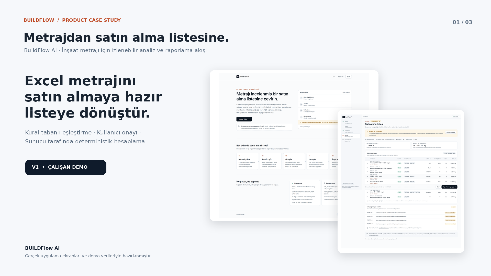

---

## Ne yapar

İnşaat metrajları tutarsız ve kısaltılmış malzeme açıklamalarıyla doludur.
Bunlardan satın alma listesi çıkarmak; açıklamaları yorumlamayı, doğru katalog
kalemini bulmayı, belirsiz varyantları çözmeyi, birimleri dönüştürmeyi, fireyi
hesaplamayı, tekrar eden kalemleri birleştirmeyi ve ticari boya yuvarlamayı
gerektirir.

BuildFlow bu iş akışının tamamını **tek bir yönlendirilmiş süreçte** toplar.

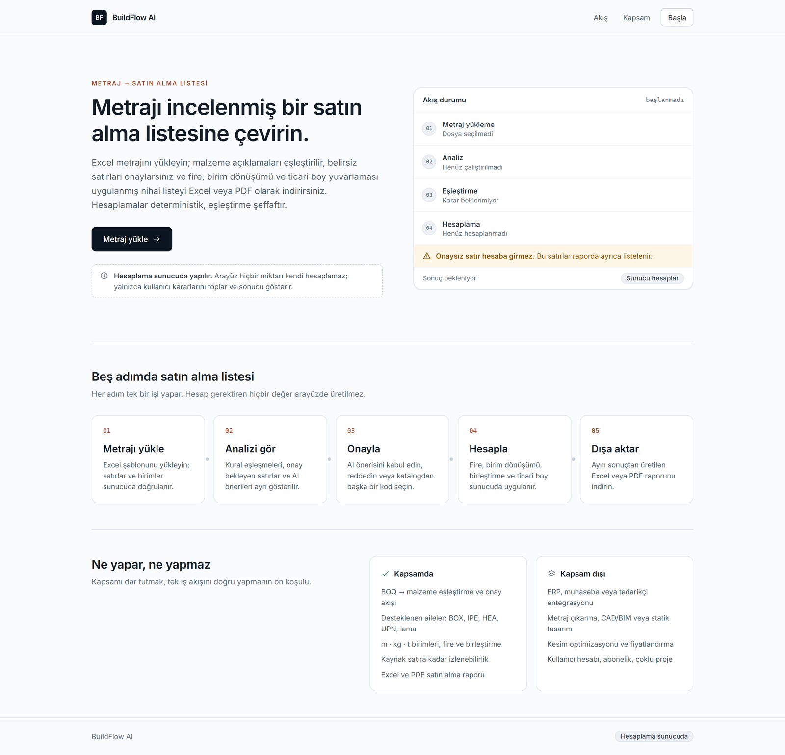

Excel metrajınızı yükleyin; uygulama açıklamaları yorumlar, katalogla
eşleştirir, belirsiz satırları size onaylatır ve fire, birim dönüşümü ve ticari
boy yuvarlaması uygulanmış nihai listeyi Excel veya PDF olarak üretir.

> Bu bir inşaat ERP'si, metraj/quantity-takeoff programı veya statik tasarım
> aracı değildir. Kapsamı dar tutar ve tek iş akışını doğru yapar.

## Nasıl çalışır

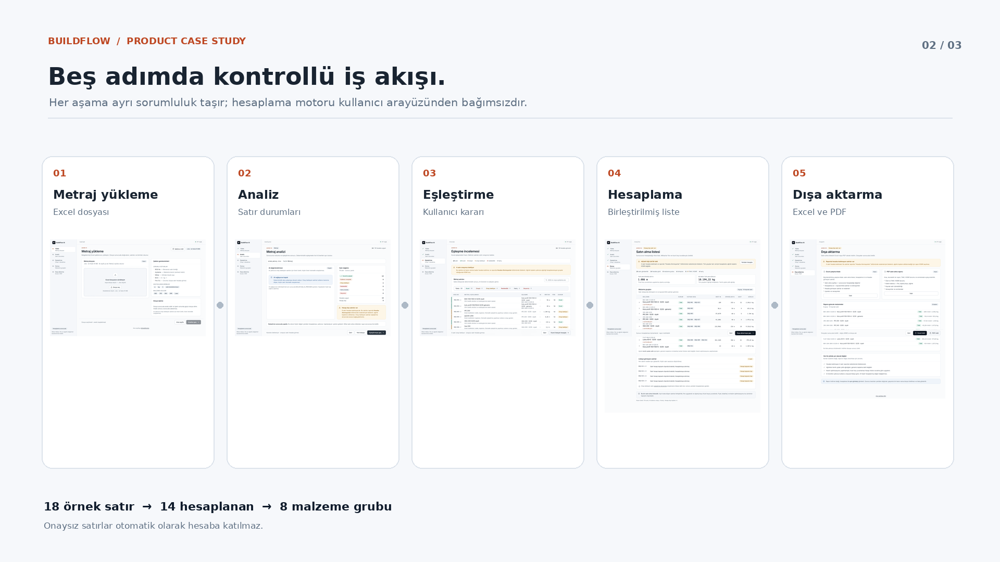

**01 · Metrajı yükle** — Belgelenmiş Excel şablonunu yükleyin. Şablonu
uygulamadan indirebilirsiniz. Satırlar ve birimler sunucuda doğrulanır; hatalar
hangi satırda neyin yanlış olduğunu söyler.

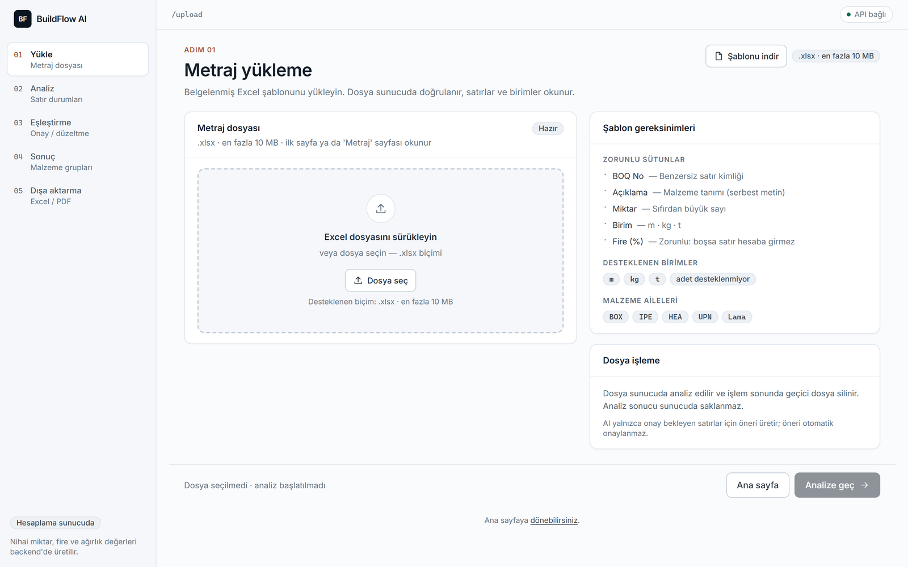

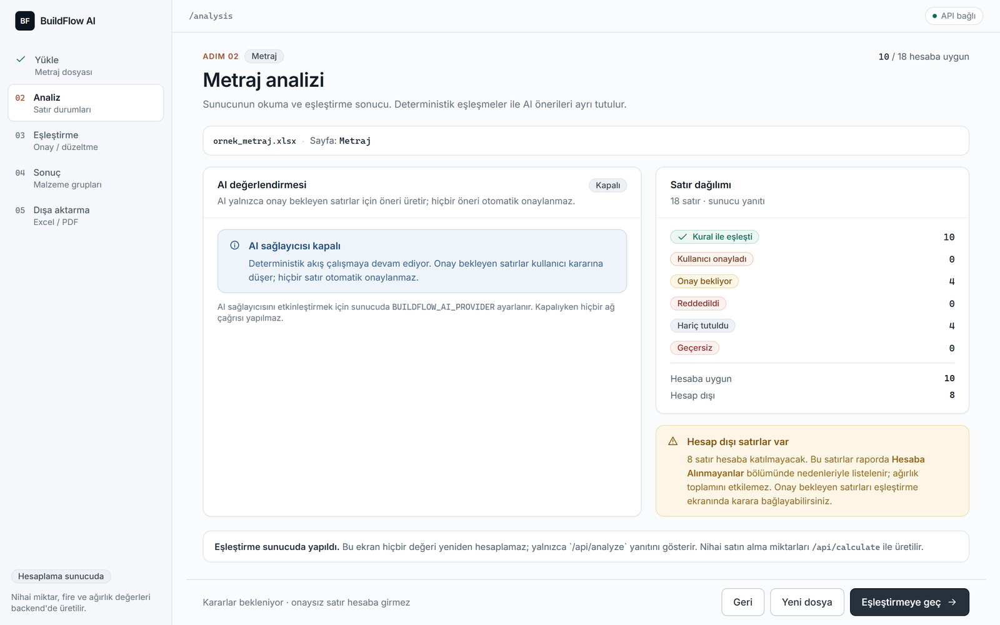

**02 · Analizi gör** — Her satır dört durumdan birine düşer: kural ile
eşleşti, onay bekliyor, hariç tutuldu veya geçersiz. Deterministik eşleşmeler
ile AI önerileri ayrı tutulur, böylece neyin makine neyin tahmin olduğu
karışmaz.

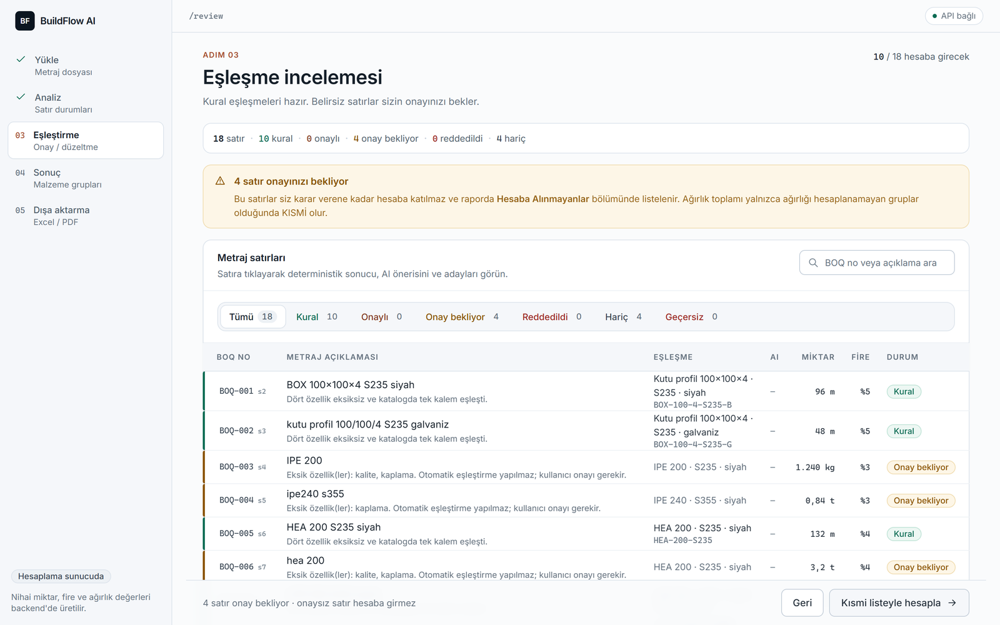

**03 · Onayla** — Yalnızca belirsiz satırlar sizin kararınızı bekler. Her satır
için katalog adaylarını, ölçüyü, kaliteyi ve kaplamayı görürsünüz; birini
onaylar, reddeder veya katalogdan başka bir kod seçersiniz.

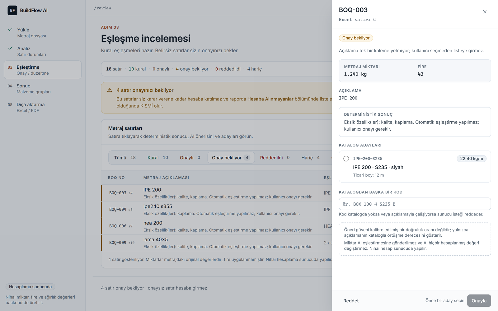

**AI önerisi asla otomatik onaylanmaz.** AI yalnızca açıklamayı yorumlar ve
aday gösterir; miktar, birim, fire, ağırlık ve maliyet AI'a hiç gönderilmez.
AI hiçbir hesaplanmış değeri değiştiremez.

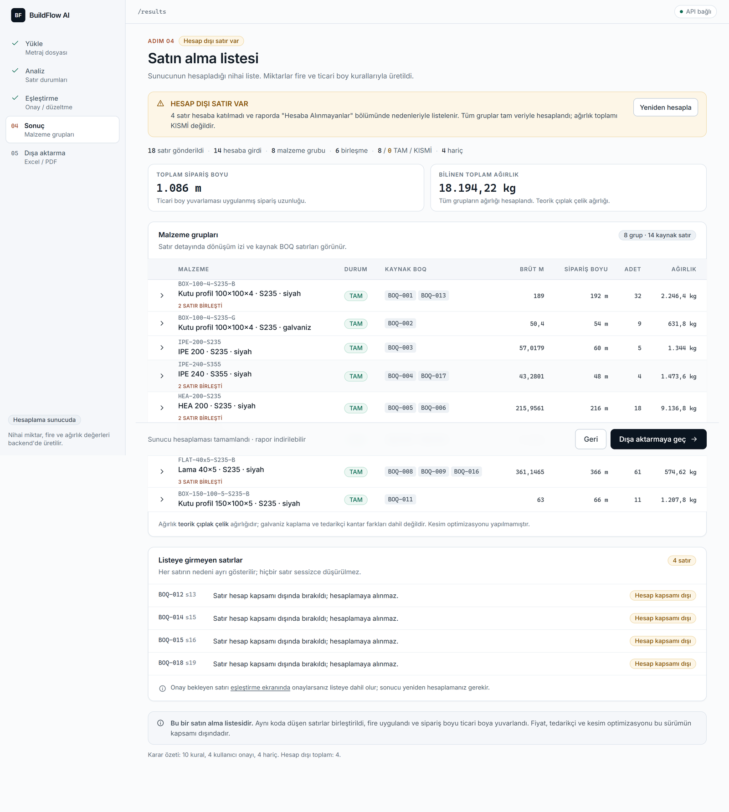

**04 · Hesapla** — Fire, birim dönüşümü, tekrar eden kalemlerin birleştirilmesi
ve ticari boya yuvarlama sunucuda uygulanır. Sonuç **TAM** veya **KISMİ** olarak
işaretlenir; listeye girmeyen her satır gerekçesiyle ayrıca gösterilir.

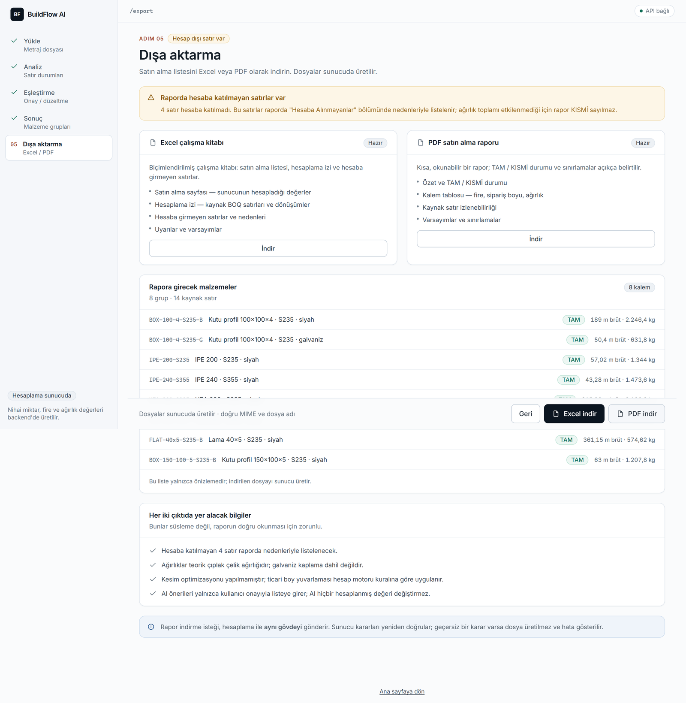

**05 · Dışa aktar** — Aynı hesaplamadan üretilen Excel çalışma kitabını veya
kısa PDF raporunu indirin. İki çıktı da sınırları ve varsayımları açıkça yazar.

## Neleri yapar

| Alan | V1'de çalışan |
|---|---|
| Girdi | Belgelenmiş Excel şablonuyla metraj yükleme (en fazla 10 MB) |
| Kapsam | BOX, IPE, HEA, UPN, lama — 14 doğrulanmış katalog kalemi |
| Birimler | m · kg · t dönüşümü |
| Eşleştirme | Net durumlar için deterministik eşleştirme |
| AI | Belirsiz açıklamalar için katalog adayı önerisi |
| Onay | Belirsiz eşleşmelerde kullanıcı kararı (onay / ret / değiştir) |
| Hesap | Net/brüt miktar, fire, birleştirme, ticari boy yuvarlaması |
| İzlenebilirlik | Her satın alma kalemi kaynak BOQ satırlarına kadar izlenebilir |
| Sonuç | Özet, satın alma listesi, dışarıda kalanlar, TAM/KISMİ durumu |
| Çıktı | Biçimlendirilmiş Excel çalışma kitabı + PDF rapor |
| Dayanıklılık | AI kapalıyken veya erişilemezken akış deterministik olarak çalışır |
| Dil | Türkçe arayüz ve Türkçe raporlar |

### Neleri yapmaz

ERP, muhasebe veya tedarikçi entegrasyonu · metraj çıkarma, CAD/BIM veya statik
tasarım · kesim optimizasyonu ve nesting · fiyat, maliyet veya teklif hesabı ·
kullanıcı hesabı, abonelik veya çoklu proje yönetimi · veritabanı.

## Örnek dosyalar ve çıktılar

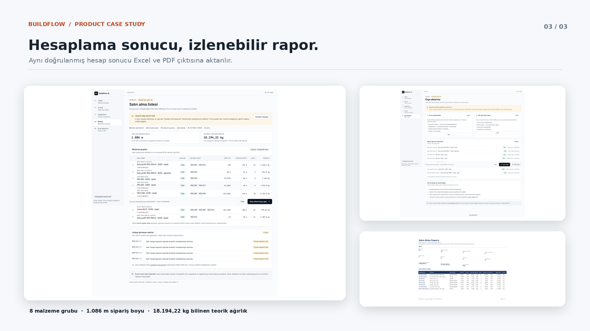

Depoda gerçek uygulamadan üretilmiş iki şablon ve bir demo metrajı bulunur:

| Dosya | Nedir |
|---|---|
| [`templates/metraj_sablonu.xlsx`](templates/metraj_sablonu.xlsx) | Kullanıcıya verilecek boş metraj şablonu (kullanım sayfası dahil) |
| [`templates/ornek_metraj.xlsx`](templates/ornek_metraj.xlsx) | 18 satırlık demo metraj — eksik açıklama, farklı birim ve belirsiz varyant içerir |
| [`docs/examples/ornek-satin-alma-raporu.xlsx`](docs/examples/ornek-satin-alma-raporu.xlsx) | Bu demo metrajından üretilmiş gerçek Excel raporu |
| [`docs/examples/ornek-satin-alma-raporu.pdf`](docs/examples/ornek-satin-alma-raporu.pdf) | Aynı hesaplamadan üretilmiş gerçek PDF raporu (2 sayfa) |

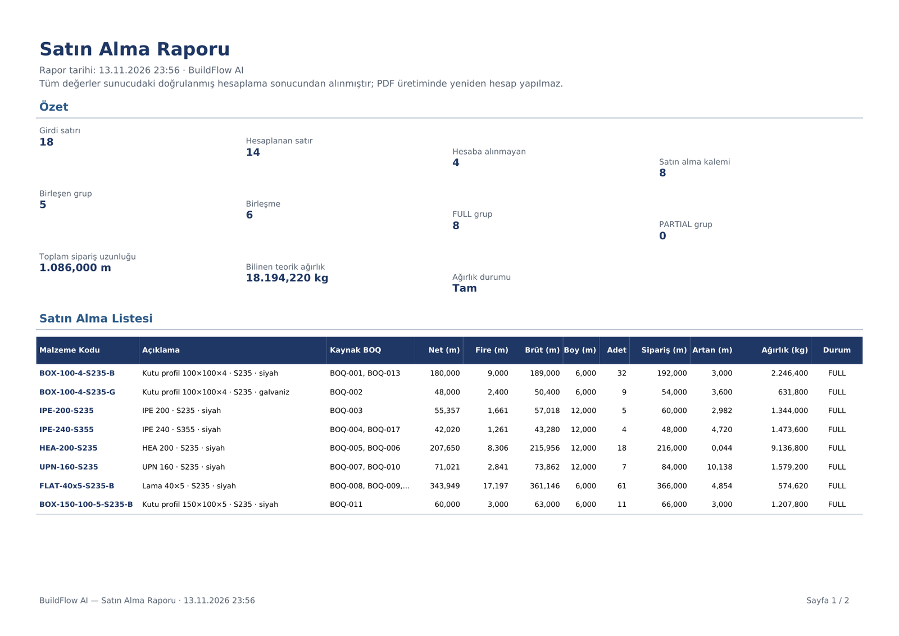

Excel raporu dört sayfa içerir: `Özet`, `Satın Alma Listesi`, `Kaynak Satırlar`
ve `Hesaba Alınmayanlar`. PDF raporu iki sayfalık özet sunar.

> Metraj dosyasının elle düzenlenmemesi gerekir; ayrıntı için
> [`templates/README.md`](templates/README.md).

## Teknoloji

| Katman | Teknoloji |
|---|---|
| Frontend | React + TypeScript + Vite |
| Stil | Tailwind CSS v4 |
| Backend | Python + FastAPI |
| Hesap | Python `Decimal` (deterministik) |
| Raporlama | openpyxl (Excel) + fpdf2 (PDF) |
| Test | Pytest (backend) + Vitest (frontend) |
| CI | GitHub Actions |

Hesap mantığı UI'dan bağımsızdır ve AI'dan hiçbir değer almaz.

## Hızlı başlangıç

**Gereksinimler:** Node.js 22.22.2+ · Python 3.12+

```powershell
# Backend
cd backend
python -m venv .venv
.\.venv\Scripts\Activate.ps1
python -m pip install -e ".[dev]"
uvicorn app.main:app --reload

# Frontend (ikinci terminal)
cd frontend
npm install
npm run dev
```

Arayüz <http://localhost:5173> adresinde açılır.

Kurulum ayrıntıları, ortam değişkenleri, test komutları ve CI yapılandırması
için: [`docs/development.md`](docs/development.md)

## Dokümantasyon

| Belge | İçerik |
|---|---|
| [`docs/architecture.md`](docs/architecture.md) | Katmanlar, klasör yapısı, hesap çekirdeği, katalog |
| [`docs/api.md`](docs/api.md) | Endpoint sözleşmeleri, istek/yanıt, hata kodları |
| [`docs/ai.md`](docs/ai.md) | AI eşleştirme, yanıt doğrulama, sağlayıcı ayarı |
| [`docs/reports.md`](docs/reports.md) | Excel/PDF rapor içeriği, sınırlar, font |
| [`docs/frontend.md`](docs/frontend.md) | Veri akışı, ekranlar, hata yönetimi, test yaklaşımı |
| [`docs/development.md`](docs/development.md) | Kurulum, çalıştırma, testler, CI |
| [`ROADMAP.md`](ROADMAP.md) | Ürün kapsamı ve geliştirme planı (tek doğruluk kaynağı) |

## Durum

V1 tamamlanmıştır: metraj yükleme, deterministik hesap, AI destekli eşleştirme,
kullanıcı onayı ve Excel/PDF raporlama uçtan uca çalışır. Arayüz prototip veri
kullanmaz; altı endpoint'in tamamı gerçek servisten beslenir.

Doğrulama: backend 871 test, frontend 178 test, üretim derlemesi ve CI yeşil.

## Yol haritası

V1 kapsamı tamamlandı. V1 sonrası değerlendirilecek başlıklar
[`ROADMAP.md`](ROADMAP.md) Bölüm 12'de listelenmiştir: daha büyük katalog ve
ek profiller, ek metraj şablonları ve içe aktarma biçimleri, proje geçmişi ve
kalıcı saklama, çok kullanıcılı iş birliği, tedarikçi fiyatları ve maliyet
hesabı, ERP entegrasyonları, CAD/BIM metraj çıkarma ve kesim optimizasyonu.

Bu başlıklar **henüz uygulanmamıştır**; V1'de yer almazlar.
